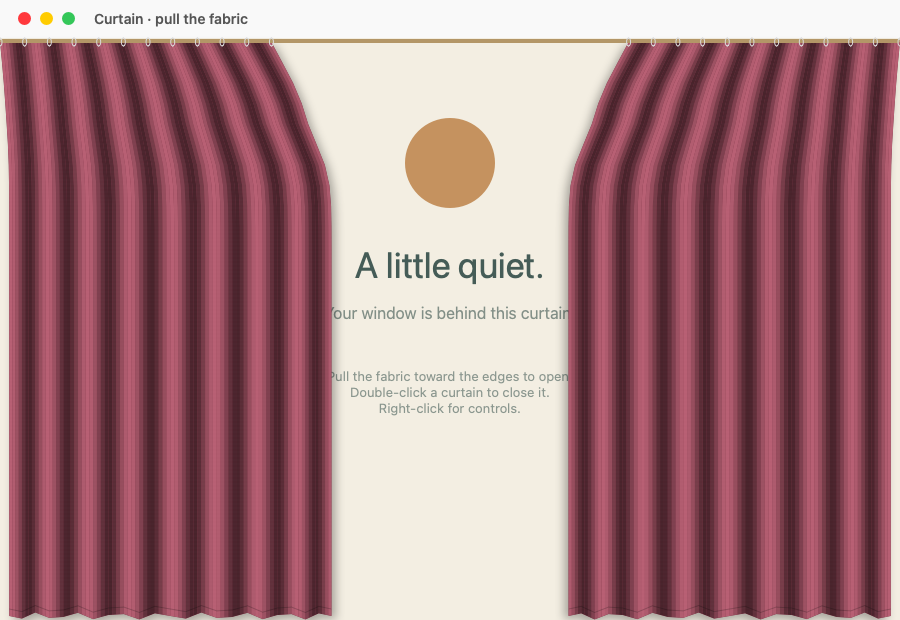
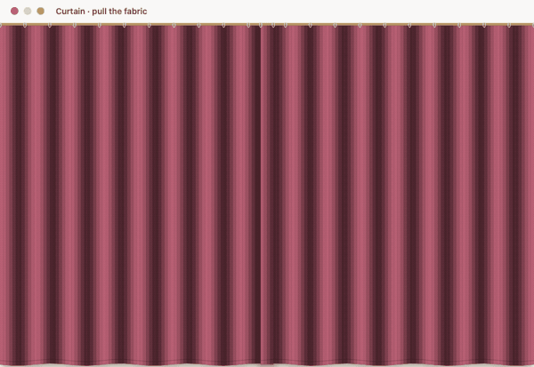

# Curtain

[English](README.md) | [Русский](README.ru.md)

Interactive curtains for real macOS windows. A native Swift and AppKit menu bar app with no third-party dependencies. Requires macOS 14 or later, on Apple Silicon or Intel.

English is the default interface language, regardless of the macOS language. Choose **Language → English / Русский** to switch instantly without restarting; your choice is saved. You can also use the language picker in the welcome window. In Russian, the submenu is called **«Язык»**. Menus, welcome and demo windows, colors, context menus, sliders, tooltips, accessibility labels, permission dialogs, and fallback window names are translated.



Native AppKit rendering of the demo window. The animation below shows the actual cloth simulation.



[Watch the short video (MP4)](docs/assets/demo.mp4)

## Download and launch

1. Download `Curtain-VERSION-universal.zip` from the [latest release](https://github.com/Hydrock/Curtain/releases/latest).
2. Unzip it, move `Curtain.app` to Applications, and open it. A curtain icon appears in the menu bar.
3. Choose **Try the demo**. The demo needs no window-access permission.

Release builds are ad hoc signed and are **not notarized**. macOS may block opening them. Developer ID signing and Apple notarization are not configured; these are needed for normal trusted distribution to other Macs. `SHA256SUMS.txt` accompanies each release for integrity checks.

To attach curtains to another app:

1. Choose **Allow window access…** from the menu bar, or **Choose a window…** in the welcome window.
2. In **System Settings → Privacy & Security → Device Control and Data Access**, enable Curtain. Earlier macOS versions call this panel **Accessibility**. If Curtain is missing, add the app using **+**.
3. Open the Curtain menu and choose **Attach curtains to a window**, then select a window.

You grant permission yourself. Screen Recording permission is unnecessary. Curtain does not connect to the network or save window contents.

## Controls and features

Choose **About and controls…** to reopen the welcome window; its **Try the curtains** button opens the demo.

- Drag any point of the fabric; neighboring areas follow it.
- Pull toward the outside edge by more than 50 points and release to gather the curtain. Pull toward the middle to close it.
- Double-click either curtain to toggle its position. Right-click for **Open curtains**, **Close curtains**, or **Remove curtains**.
- The menu bar offers **Open all curtains**, **Close all curtains**, four colors under **Fabric** (Velvet · Burgundy, Velvet · Forest, Velvet · Midnight, and Linen · Sand), and **Remove all curtains**. **Quit Curtain** removes all curtains and exits the app.
- **Transparency** ranges from 0% (opaque) to 90% (almost transparent). It applies immediately to all curtains, including new ones, and is saved between launches.
- **Curtain sound** toggles the fabric rustle. **Volume** adjusts it from 0–100%, starting at 35%. Both settings persist. Moving both curtains together plays the sound once.

Curtains follow the window's position and size and hide when it is minimized or another window becomes active. They return when the selected window is active again. The title bar remains accessible, and clicks in the open gap pass through to the original app.

## A breeze through the window

Enable **Wind** in the Curtain menu and adjust **Wind strength** from 0–100%.
Low settings gently sway the fabric; 100% produces strong, broad gusts.
The strength curve is gradual at the low end and rises sharply near maximum,
with extra flutter in stronger wind. Motion is strongest near the free hem. The top rings stay
fixed and dragging still follows your hand. Switching wind on or off fades the
force smoothly; it never triggers curtain sound effects. Both settings are saved
and apply to existing and newly attached windows. Wind is off by default, with
35% strength ready when enabled. Setting strength to 0 gives still air.

## Build and test

Install Xcode Command Line Tools (`xcode-select --install`), then:

```sh
git clone https://github.com/Hydrock/Curtain.git
cd Curtain
./build.sh
open build/Curtain.app
```

`./build.sh` builds for the current Mac's architecture. To build both Apple Silicon and Intel:

```sh
./build.sh --universal
```

Run the full test suite in a macOS graphical session, or the core, settings, and audio tests without GUI access:

```sh
./test.sh
./test.sh --headless
```

Tests cover cloth physics, demo-window attachment, gestures, transparency, volume, settings persistence, and audio loading. You can also open `Package.swift` in Xcode. For regular use, launch the `.app` produced by `build.sh`, which has a stable application identifier. Changing a local signature may require adding Curtain to the permission list again.

To package a universal build locally:

```sh
./release.sh 1.2.1
```

Packages are written to `build/releases`. Pushing a version tag such as `v1.2.1` runs `.github/workflows/release.yml`, builds a universal app, and publishes `Curtain-VERSION-universal.zip` and `SHA256SUMS.txt` in a GitHub Release.

## How it works and known limits

Cloth uses a spring-like displacement grid with fixed top rings, damping, and gathering, updated at 60 Hz. This is stylized physics without self-collision or a full 3D cloth simulation. Window geometry follows macOS Accessibility notifications with a 60 Hz fallback; position, size, and minimized state are read together. Focus is checked on notifications and every 100 ms as a fallback.

Target apps must support the Accessibility API. Some games, custom windows, full-screen modes, and Stage Manager may behave differently. A fixed 30-point title-bar inset is used; unusual title bars may need an adjustment in `CurtainAttachment.body`. Window attachments are not restored after restarting.

The bundled audio derives from a user-provided recording. Original distribution rights have not been independently verified; see [Resources/Sound-LICENSE.txt](Resources/Sound-LICENSE.txt).
