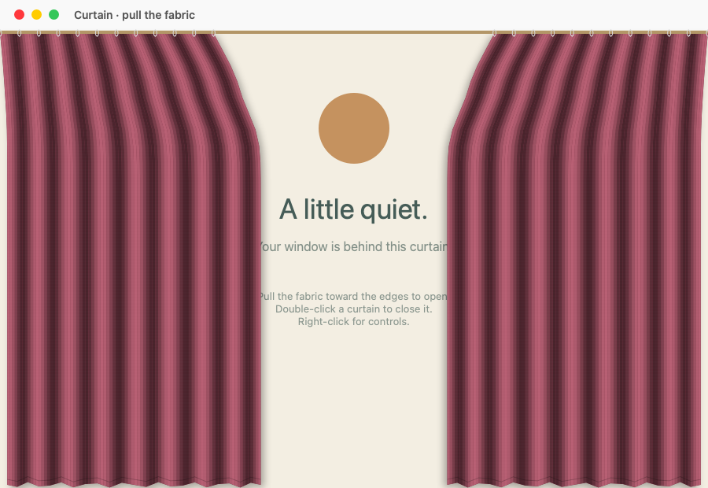
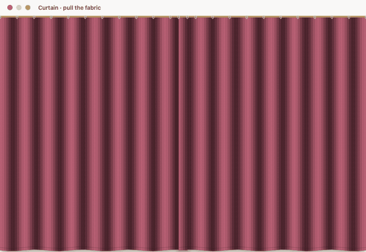
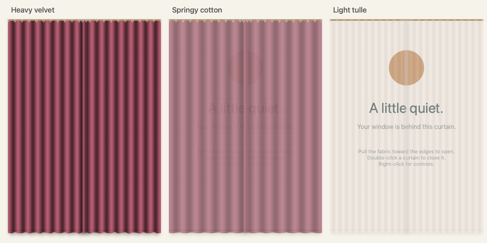

# Curtain

[English](README.md) | [Русский](README.ru.md)

Интерактивные шторы для настоящих окон macOS. Нативное приложение для строки меню на Swift и AppKit без сторонних библиотек. Требуется macOS 14 или новее, Apple Silicon или Intel.

По умолчанию интерфейс на английском независимо от языка macOS. Выберите **Language → Русский**, чтобы переключиться на русский. После переключения подменю называется **«Язык»**: в нём доступны **English / Русский**. Выбрать язык также можно в приветственном окне. Язык меняется сразу, без перезапуска, и сохраняется между запусками. Переведены меню, приветственное и демонстрационное окна, цвета, контекстные меню, ползунки, подсказки, подписи для универсального доступа, диалоги разрешений и резервные названия окон. Инструкции ниже используют русские названия пунктов; снимки и видео показывают английский интерфейс.



Нативная отрисовка демонстрационного окна в AppKit. Анимация ниже показывает настоящую симуляцию ткани.



[Короткое видео (MP4)](docs/assets/demo.mp4)

## Скачать и запустить

1. Скачайте `Curtain-VERSION-universal.zip` из [последнего релиза](https://github.com/Hydrock/Curtain/releases/latest).
2. Распакуйте архив, перенесите `Curtain.app` в Applications и откройте. В строке меню появится значок штор.
3. Выберите **«Попробовать на демо-окне»**. Для демо разрешение на доступ к окнам не нужно.

Релизные сборки имеют локальную подпись (ad hoc) и **не нотариализованы**. macOS может заблокировать их запуск. Подпись Developer ID и нотариализация Apple не настроены; они нужны для обычного доверенного распространения на другие Mac. К каждому релизу прилагается `SHA256SUMS.txt` для проверки целостности файлов.

Чтобы повесить шторы на окно другого приложения:

1. Выберите **«Разрешить доступ к окнам…»** в строке меню или **«Выбрать окно…»** в приветственном окне.
2. В **System Settings → Privacy & Security → Device Control and Data Access** включите Curtain. В более ранних версиях macOS этот раздел называется **Accessibility** («Универсальный доступ»). Если Curtain нет в списке, добавьте приложение кнопкой **+**.
3. В меню Curtain выберите **«Повесить шторы на окно»**, затем нужное окно.

Разрешение включает сам пользователь. Запись экрана не нужна. Curtain не подключается к сети и не сохраняет содержимое окон.

## Управление и возможности

Пункт **«О приложении и управление…»** снова открывает приветственное окно; кнопка **«Попробовать шторы»** в нём запускает демо.

- Тяните за любую точку ткани: соседние участки последуют за ней.
- Потяните к внешнему краю окна более чем на 50 точек и отпустите — штора соберётся. Потяните к середине — штора закроется.
- Двойной щелчок по любой шторе переключает её положение. Правый щелчок открывает меню: **«Открыть шторы»**, **«Закрыть шторы»**, **«Снять шторы»**.
- В строке меню доступны **«Открыть все шторы»**, **«Закрыть все шторы»**, четыре цвета в подменю **«Цвет»** («Винный», «Хвойный», «Песочный», «Ночной») и **«Снять все шторы»**. Завершение приложения убирает все шторы.
- **«Прозрачность»** добавляет от 0 до 90% прозрачности к собственной плотности материала; тюль остаётся полупрозрачным даже при 0%. Изменение сразу применяется ко всем шторам, включая новые, и сохраняется между запусками.
- **«Звук штор»** включает и отключает шорох ткани. **«Громкость»** регулирует его от 0 до 100%, начальное значение — 35%. Обе настройки сохраняются. У каждого материала отдельные тихие звуки открытия и закрытия, полученные из той же предоставленной пользователем записи. Одновременное движение обеих штор звучит один раз. Обработка описана в [Resources/MaterialSounds.txt](Resources/MaterialSounds.txt).

Шторы следуют за перемещением и размером окна, скрываются при сворачивании или переключении на другое окно и возвращаются при активации выбранного окна. Заголовок остаётся доступен, а клики в открытом промежутке проходят к исходному приложению.

## Материалы

В меню **«Материал»** выберите **«Тяжёлый бархат»**, **«Упругий хлопок»** или **«Лёгкий тюль»**. Материал также можно выбрать в приветственном окне. По умолчанию выбран бархат, сохраняющий прежний вид. Выбор сохраняется и сразу применяется к существующим и новым шторам, не сбрасывая симуляцию и не меняя открытое или закрытое положение.

| Материал | Вид | Движение |
| --- | --- | --- |
| Тяжёлый бархат | Восемь глубоких складок, непрозрачный | Тяжёлый, с сильным затуханием |
| Упругий хлопок | Шесть неглубоких матовых складок, непрозрачность 94% | Более упругий |
| Лёгкий тюль | Двенадцать тонких складок, светлый оттенок и редкое плетение, непрозрачность 32% | Лёгкий, отзывчивый к ветру |

Материалы различаются массой, затуханием, жёсткостью, скоростью открытия и реакцией на ветер. **«Цвет»** выбирается отдельно. Непрозрачность карниза не зависит от плотности материала.



## Ветер из окна

Включите **«Ветер»** в меню Curtain и настройте **«Силу ветра»** от 0 до 100%.
При малой силе ткань едва колышется; на 100% — сильные широкие порывы.
Шкала нелинейная: на малых значениях движение остаётся мягким, к максимуму быстро
усиливается и добавляет более частые волны. Сильнее движется свободный нижний край. Верхние кольца
закреплены; при перетаскивании ткань продолжает следовать за рукой.
Ветер включается и затихает плавно, не вызывает звук открытия и закрытия.
Обе настройки сохраняются и применяются к существующим и новым шторам.
По умолчанию ветер выключен; начальная сила при включении — 35%. Значение 0% — штиль.

## Сборка и тесты

Установите Command Line Tools для Xcode (`xcode-select --install`), затем:

```sh
git clone https://github.com/Hydrock/Curtain.git
cd Curtain
./build.sh
open build/Curtain.app
```

`./build.sh` собирает приложение для архитектуры текущего Mac. Для сборки одновременно под Apple Silicon и Intel:

```sh
./build.sh --universal
```

Полный набор тестов запускается в графической сессии macOS. Тесты физики, настроек и аудио можно запустить без графического интерфейса:

```sh
./test.sh
./test.sh --headless
```

Тесты проверяют физику ткани, привязку демо-штор к окну, жесты, прозрачность, громкость, сохранение настроек и загрузку аудио. `Package.swift` также можно открыть в Xcode. Для обычного использования запускайте `.app`, собранный `build.sh`: у него постоянный идентификатор приложения. При изменении локальной подписи macOS может потребовать повторно добавить Curtain в список разрешений.

Чтобы локально упаковать универсальную сборку:

```sh
./release.sh 1.3.0
```

Пакеты сохраняются в `build/releases`. Отправка тега версии, например `v1.3.0`, запускает `.github/workflows/release.yml`: процесс собирает универсальное приложение и публикует `Curtain-VERSION-universal.zip` и `SHA256SUMS.txt` в GitHub Release.

## Устройство и ограничения

Ткань моделируется упругой сеткой смещений с закреплёнными верхними кольцами, затуханием и сборкой; обновление идёт с частотой 60 Гц. Это стилизованная физика без самоколлизий и полноценного трёхмерного расчёта ткани. Геометрия окон обновляется по уведомлениям macOS Accessibility с резервным опросом 60 Гц; положение, размер и свёрнутое состояние читаются вместе. Фокус проверяется по уведомлениям и резервно каждые 100 мс.

Окна приложений должны поддерживать Accessibility API. Некоторые игры, нестандартные окна, полноэкранные режимы и Stage Manager могут вести себя иначе. Используется фиксированный отступ заголовка 30 точек; необычные заголовки могут потребовать настройки в `CurtainAttachment.body`. Привязки к окнам после перезапуска не восстанавливаются.

Встроенное аудио получено из записи, предоставленной пользователем. Права на распространение оригинала независимо не проверялись; см. [Resources/Sound-LICENSE.txt](Resources/Sound-LICENSE.txt).
